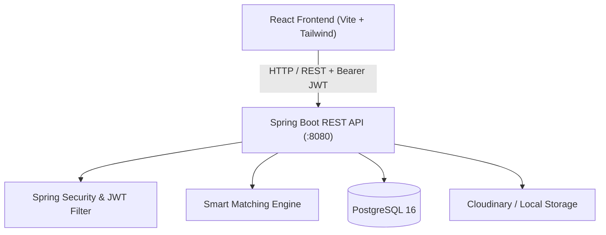
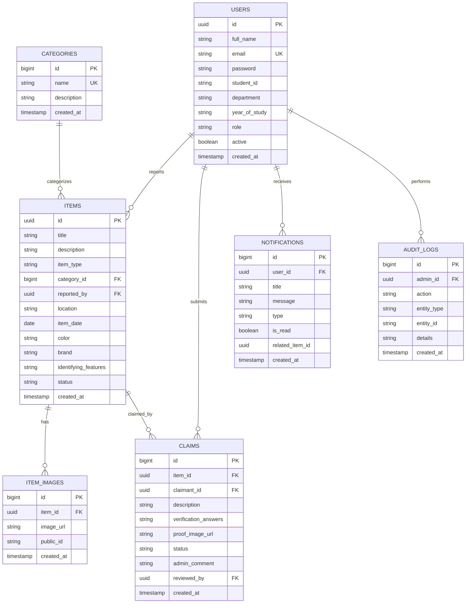

# FindIt – Campus Lost & Found Platform

FindIt is a production-quality, centralized web application designed for university campuses to streamline the reporting, tracking, and recovery of lost and found belongings. It eliminates fragmented communications across student messaging groups by providing automated similarity matching, verification claims workflows, and administrative moderation.

---

## 1. Key Features

- **Role-Based Access Control**:
  - **Student Role**: Register, report lost/found items with multi-image upload, browse and filter listings, receive automated potential match notifications, submit ownership claims, provide additional verification proof, track personal claims and reports.
  - **Admin Role**: Moderate listings, review claims with uploaded proof images, approve/reject claims (with concurrency-safe single-award enforcement), request additional verification, mark items as resolved/returned, manage categories, suspend/reactivate users, view analytics, and audit logs.
- **Smart Weighted Matching Engine**:
  - Compares reports across Category (25 pts), Title text similarity (25 pts), Description keyword overlap (20 pts), Color (10 pts), Brand (10 pts), and Location & Date proximity (10 pts).
  - Scores $\ge 50\%$ generate match recommendations and trigger in-app notification alerts for report owners.
- **Ownership Verification & Concurrency Control**:
  - Enforces database transactions (SERIALIZABLE isolation) preventing duplicate or competing claims from simultaneously being awarded.
  - Automatically marks item as returned and informs competing claimants when a claim is approved.
- **Dual Image Storage Engine**:
  - Integrated with **Cloudinary** for cloud CDN storage.
  - Automatic fallback to **Local Storage** (`/uploads/**`) when credentials are omitted, allowing zero-setup offline local development.
- **Interactive Analytics**:
  - Monthly reporting trends and category distribution charts powered by Recharts.
- **OpenAPI & Swagger Documentation**:
  - Interactive API explorer at `/swagger-ui.html`.

---

## 2. Technology Stack

### Frontend
- **Framework**: React 18+ with Vite
- **Styling**: Tailwind CSS
- **Routing**: React Router DOM v6
- **HTTP Client**: Axios with automated JWT Bearer & Refresh interceptors
- **Form Management & Validation**: React Hook Form with Zod schemas
- **Icons**: Lucide React
- **Data Visualizations**: Recharts
- **Notifications**: React Hot Toast
- **Testing**: Vitest & React Testing Library with jsdom

### Backend
- **Language & Runtime**: Java 17 / 21
- **Framework**: Spring Boot 3.3.4
- **Security**: Spring Security 6 with JWT (jjwt 0.12.5) & BCrypt password hashing
- **Database Access**: Spring Data JPA & Hibernate
- **Migrations**: Flyway
- **File Storage**: Cloudinary SDK (with local disk fallback)
- **API Documentation**: Springdoc OpenAPI 2.5.0
- **Testing**: JUnit 5, Mockito, Spring Boot Test

### Database
- **Primary**: PostgreSQL 16
- **Test / In-Memory**: H2 Database (PostgreSQL mode)

---

## 3. System Architecture



---

## 4. Entity-Relationship (ER) Diagram



---

## 5. Development Setup & Execution

### Prerequisites
- Java 17+ & Maven 3.8+
- Node.js 18+ & npm
- Docker (optional, for running PostgreSQL container)

### Step 1: Start PostgreSQL Database
Using Docker Compose:
```bash
docker compose up -d
```
Or use an existing PostgreSQL instance and create a database named `findit_db`:
```sql
CREATE DATABASE findit_db;
```

### Step 2: Backend Configuration & Execution
1. Navigate to the backend directory:
   ```bash
   cd backend
   ```
2. Verify environment settings in `.env` (or set environment variables):
   ```bash
   cp .env.example .env
   ```
3. Run the Spring Boot application:
   ```bash
   mvn spring-boot:run
   ```
   The backend starts at `http://localhost:8080`. Flyway will automatically execute database migrations (`V1__init_schema.sql`, `V2__seed_categories.sql`), and the default administrator account will be initialized.

### Step 3: Frontend Configuration & Execution
1. Navigate to the frontend directory:
   ```bash
   cd frontend
   ```
2. Install dependencies (if not already installed):
   ```bash
   npm install
   ```
3. Start the Vite development server:
   ```bash
   npm run dev
   ```
   The frontend runs at `http://localhost:5173`.

---

## 6. Default Development Accounts

A default campus administrator account is created at backend startup:

| Role | Email | Password |
|---|---|---|
| **Admin** | `admin@findit.campus.edu` | `Admin@FindIt2026` |
| **Student** | Any student account registered via `/register` | Chosen password |

---

## 7. Cloudinary & Storage Configuration

If you have a Cloudinary account, configure your keys in `backend/.env`:
```env
CLOUDINARY_CLOUD_NAME=your_cloud_name
CLOUDINARY_API_KEY=your_api_key
CLOUDINARY_API_SECRET=your_api_secret
```
*Note*: If these variables are left empty, the application automatically uses local disk storage in `./uploads` and serves uploaded images through the static path `/uploads/**`. No paid account or external service is required for local testing!

---

## 8. REST API Reference

### Authentication (`/api/auth`)
- `POST /api/auth/register` - Register a student account
- `POST /api/auth/login` - Authenticate and obtain JWT access & refresh tokens
- `POST /api/auth/refresh` - Refresh access token using refresh token
- `POST /api/auth/logout` - Logout user
- `GET /api/auth/me` - Get authenticated user profile

### User Profile (`/api/users`)
- `GET /api/users/profile` - Current user profile
- `PUT /api/users/profile` - Update student profile details
- `GET /api/users/{id}` - Public user profile

### Items (`/api/items`)
- `POST /api/items` - Report lost or found item (multipart with optional images)
- `GET /api/items` - Search and filter items (pagination, categories, types, dates)
- `GET /api/items/featured` - Get featured items for landing page
- `GET /api/items/search?q={query}` - Quick keyword search
- `GET /api/items/my-reports` - Get reports posted by authenticated student
- `GET /api/items/{id}` - Item details
- `GET /api/items/matches/{id}` - Run matching algorithm for item
- `PUT /api/items/{id}` - Edit item report (owner/admin)
- `DELETE /api/items/{id}` - Delete item report (owner/admin)

### Claims (`/api/claims`)
- `POST /api/claims` - Submit ownership claim for found item (multipart with proof image)
- `GET /api/claims/my-claims` - List submitted claims for student
- `GET /api/claims/{id}` - Claim details
- `PUT /api/claims/{id}/additional-information` - Provide requested verification information

### Notifications (`/api/notifications`)
- `GET /api/notifications` - Paginated user notifications
- `GET /api/notifications/unread-count` - Count of unread alerts
- `PATCH /api/notifications/{id}/read` - Mark single notification as read
- `PATCH /api/notifications/read-all` - Mark all notifications as read

### Categories (`/api/categories`)
- `GET /api/categories` - List categories
- `POST /api/admin/categories` - Create category (Admin)
- `PUT /api/admin/categories/{id}` - Update category (Admin)
- `DELETE /api/admin/categories/{id}` - Delete category (Admin)

### Admin Operations (`/api/admin`)
- `GET /api/admin/dashboard` - High-level metrics & trends
- `GET /api/admin/analytics` - Platform analytics
- `GET /api/admin/items` - Moderation queue of listings
- `GET /api/admin/claims` - Claims review queue
- `GET /api/admin/claims/{id}` - Specific claim details
- `PATCH /api/admin/claims/{id}/approve` - Approve claim & mark item returned
- `PATCH /api/admin/claims/{id}/reject` - Reject claim
- `PATCH /api/admin/claims/{id}/request-information` - Request additional verification
- `PATCH /api/admin/items/{id}/resolve` - Mark listing as resolved
- `PATCH /api/admin/items/{id}/remove` - Delete listing
- `GET /api/admin/users` - List registered users
- `PATCH /api/admin/users/{id}/suspend` - Suspend user account
- `PATCH /api/admin/users/{id}/activate` - Activate user account
- `GET /api/admin/audit-logs` - View security audit log trail

---

## 9. Running Tests

### Backend Tests (JUnit 5 + Mockito)
```bash
cd backend
mvn test
```
*Result: 16 passing unit and controller tests covering authentication, hashing, claim safety, item lifecycle, and matching engine scoring.*

### Frontend Tests (Vitest + React Testing Library)
```bash
cd frontend
npm test
```
*Result: 5 passing tests covering badge variants, listing cards, and authentication form components.*

